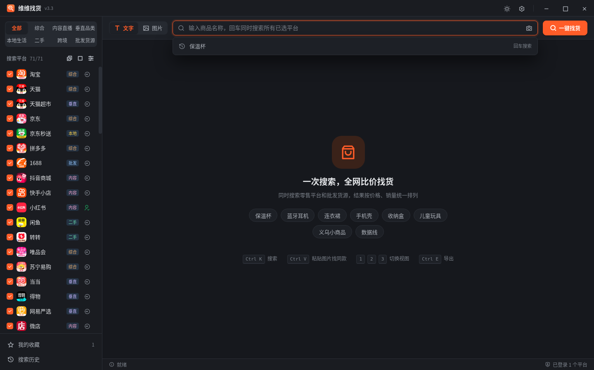
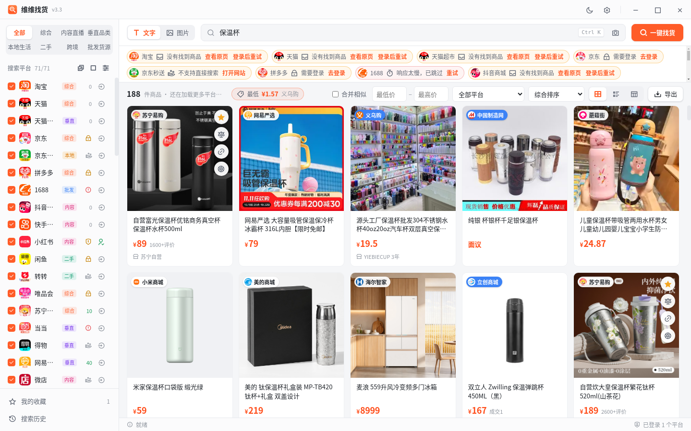

# 维维找货

**3.4.0** · 跨电商平台一键找货桌面工具：在多个采购与零售平台上搜索货源，登录态按平台持久化。

## 功能特性

- 一键在多个电商平台找货、比对。
- 新增平台：编辑 `src/platforms.js`，补充搜索 URL、登录 Cookie 与能力矩阵。
- 每个平台独立 `persist:<id>` 会话（淘宝 / 天猫 / 闲鱼共享 `persist:taobao`），数据在 `%APPDATA%/维维找货`。

## 下载

本仓库目前没有已发布的 GitHub Release 安装包。请从源码运行。GitHub 自动生成的 Source code zip/tar 不算安装包。

## 界面截图

以下为仓库外 e2e-v33 目录中已目视确认的真实产品窗口，窗口标题为「维维找货 v3.3」。README 标注的产品版本是 **3.4.0**，因此这些图不是 3.4.0，也不是 Windows 安装包安装后的截图。搜索词「保温杯」为示例查询。未使用设置页或密钥页截图。

| 工作台（v3.3，深色主题） | 卡片结果（示例查询「保温杯」） |
| --- | --- |
|  |  |

## 技术栈

- Electron
- JavaScript

## 从源码运行

源码在仓库根目录。本仓库不包含安装包。

```bash
npm install
npm start
```
## 文档

- [产业带研究](产业带研究.md)
- [3.4 界面评审](ui-review-3.4.md)

## 贡献

欢迎通过 Issue 和 Pull Request 参与，详见 [CONTRIBUTING.md](CONTRIBUTING.md)。安全问题请按 [SECURITY.md](SECURITY.md) 私下报告。参与时请遵守 [CODE_OF_CONDUCT.md](CODE_OF_CONDUCT.md)。

## 许可证

本仓库尚未附带 LICENSE 文件，许可证未指定。

---

## English

# Weiwei Zhaohuo

**3.4.0** · A desktop tool for one-click cross-platform product sourcing. Search goods across procurement and retail sites, with login state persisted per platform.

## Features

- One-click search and comparison across multiple e-commerce platforms.
- Add a platform by editing `src/platforms.js` with its search URL, login cookie, and capability matrix.
- Each platform gets a `persist:<id>` session (Taobao / Tmall / Xianyu share `persist:taobao`). Data lives in `%APPDATA%/维维找货` on Windows.

## Downloads

This repository has no published GitHub Release installer. Run it from source. The automatic Source code zip/tar from GitHub is not an installer.

## Screenshots

These shots were visually confirmed from a local e2e-v33 capture. The window title is "维维找货 v3.3". The README product version is **3.4.0**, so these are not 3.4.0 shots and not captures after a Windows installer. The query "保温杯" is sample data. Settings or API-key pages were not used.

| Workbench (v3.3, dark theme) | Card results (sample query "保温杯") |
| --- | --- |
|  |  |

## Tech stack

- Electron
- JavaScript

## Getting started

Source is at the repository root. This repository does not include installers.

```bash
npm install
npm start
```
## Documentation

- [产业带研究](产业带研究.md)
- [3.4 界面评审](ui-review-3.4.md)

## Contributing

Issues and pull requests are welcome. See [CONTRIBUTING.md](CONTRIBUTING.md). Please report vulnerabilities privately via [SECURITY.md](SECURITY.md). This project follows [CODE_OF_CONDUCT.md](CODE_OF_CONDUCT.md).

## License

No LICENSE file is included in this repository; the license is unspecified.
